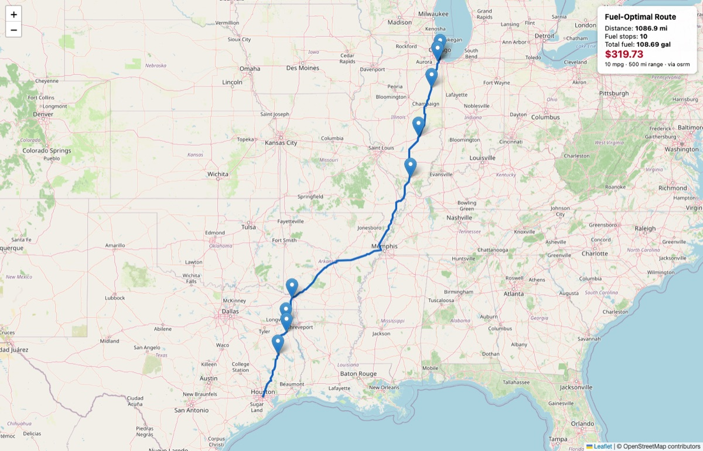

# USA Fuel-Optimal Route API

A Django REST API that, given a **start** and **finish** in the USA, returns the
driving route, the **cost-optimal fuel stops** along it, and the **total fuel
cost** — for a vehicle with a **500-mile range** at **10 mpg**, using truck-stop
prices from `fuel-prices-for-be-assessment.csv`.

It makes **exactly one** call to a free routing API per request (cached
thereafter) and adds only **tens of milliseconds** of its own processing on top of
that call, even for a 3,000-mile route; repeat requests are served from cache in
single-digit milliseconds.

---

## Quick start

Requires **Python 3.12+** (tested on 3.12 and 3.14) and runs on the current stable **Django 6.1**.

```bash
python -m venv .venv && source .venv/bin/activate
pip install -r requirements-dev.lock  # exact, hash-checked versions incl. test tooling (runtime only: requirements.lock)
cp .env.example .env                  # local settings (DEBUG=True); routing is key-free via OSRM
python manage.py migrate
python manage.py load_fuel_prices     # parses, dedups, geocodes the CSV (idempotent)
python manage.py runserver
```

Or `make setup load run` (see the `Makefile`), or `docker compose up --build`
for a production-like container (gunicorn, `DEBUG=False`, SQLite on a volume;
set `PROD_SECRET_KEY` for a real deployment — compose also reads your `.env` for
`${VAR}` values such as `ORS_API_KEY`).

No API key and no external database are required: it defaults to the keyless
public **OSRM** routing server and **SQLite**. To use the more robust
**OpenRouteService**, put a free `ORS_API_KEY` in `.env`. (`DEBUG` defaults to
`False`, so the `.env` copy is what puts a local checkout into development mode.)

### Try it

```bash
# JSON POST (place names or coordinates)
curl -s -X POST localhost:8000/api/v1/route-fuel-plan/ \
  -H 'Content-Type: application/json' \
  -d '{"start":"Chicago, IL","finish":"Houston, TX"}' | python -m json.tool

# GET form
curl -s 'localhost:8000/api/v1/route-fuel-plan/?start=Chicago,%20IL&finish=Houston,%20TX'
```

`start` / `finish` accept, in either verb: `"City, ST"`, `"City, State Name"`
(`"Chicago, Illinois"`), `"City ST"` without a comma, a bare city when it is
unambiguous (`"Chicago"`; `"Springfield"` is rejected with the list of states),
a `"lat,lng"` string, or a `{"lat": .., "lng": ..}` object. Spelling variants
such as `Winston-Salem` / `Winston Salem`, `O'Fallon` / `O Fallon` and
`St. Louis` / `Saint Louis` resolve to the same place. Optional `buffer_miles`
(0.5–50, default 7) widens the corridor searched for stations.

The response's `route.map_url` opens an interactive **Leaflet map** of the route
with the fuel stops plotted and a summary panel (distance, stops, gallons, total cost):



### Run the tests

```bash
pytest
```

### Try it in Postman

Import `docs/fuel-route-api.postman_collection.json` and run the collection
against a local server: 22 requests (health, happy paths, every error code)
with assertions, so the runner shows pass/fail per call.

---

## How it works

The CSV has **no coordinates** — only `City, State` and a free-text highway
`Address` — and the routing API must not be called repeatedly. The design
resolves this by doing all geocoding **offline, once, at load time**:

1. **Load (`load_fuel_prices`)** — parse the 8,151-row CSV (handling CRLF +
   quoted commas), drop the 620 Canadian-province rows, and dedup the 7,531 US
   rows into **6,626 stations** by OPIS ID (905 duplicate rows across 568 IDs; the
   487 IDs with conflicting prices keep the lowest). Each `(City, State)` is then
   geocoded against a vendored US-cities centroid dataset (`data/uscities.csv`),
   placing multi-county cities in their principal county. Coordinates are stored
   on the `FuelStation` table. **99.8%** of stations geocode (6,615); the 11 in
   five towns absent from the dataset are kept but excluded from routing.
   Re-running is idempotent, and running servers pick up a reload within 5 s.
2. **Per request** — make **one** routing call (OpenRouteService or OSRM) for the
   route geometry + distance. Endpoints given as `"City, ST"` are resolved
   offline, so the typical request is a single API call.
3. **Corridor** — a scipy KD-tree (built once from the table) prefilters stations
   near the route; exact membership uses the perpendicular distance to the route
   polyline, computed for all candidates at once with numpy (a 30k-point route
   takes a few milliseconds), and each station gets a "mile marker" distance from
   the start.
4. **Optimize** — the classic minimum-cost **gas-station problem** is solved with
   a provably-optimal greedy (verified against a linear program in the tests):
   at each stop, buy just enough to reach the next cheaper station within range,
   otherwise fill the tank and jump to the cheapest reachable station.

### API response shape

```json
{
  "route": {
    "geometry": { "type": "LineString", "coordinates": [[lng, lat], ...] },
    "total_distance_miles": 1100.0,
    "duration_minutes": 1198.0,
    "provider": "osrm",
    "start": {"lat": 41.88, "lng": -87.63},
    "finish": {"lat": 29.76, "lng": -95.37},
    "map_url": "http://localhost:8000/api/v1/route-fuel-plan/map/?start=..."
  },
  "fuel": {
    "mpg": 10.0, "tank_range_miles": 500.0, "start_tank_assumption": "empty",
    "total_gallons": 110.0, "total_cost_usd": "323.48"
  },
  "fuel_stops": [
    {
      "order": 1, "opis_id": 12345, "name": "...", "city": "...", "state": "IL",
      "location": {"lat": 40.0, "lng": -88.0}, "route_mile_marker": 212.3,
      "detour_miles": 0.4, "price_per_gallon": "2.999",
      "gallons_purchased": 10.7, "cost_usd": "32.10"
    }
  ]
}
```

### Errors

Every failure uses one envelope: `{"error": "<message>", "code": "<code>", ...}`.
Validation errors add `fields` (per-field messages); an unplannable route adds
`infeasible_segment` and, while a wider corridor could still help, a `hint`.

| Status | `code` | When |
|--------|--------|------|
| 400 | `invalid_input` | Missing/malformed fields, place name too long, coordinates out of range, `buffer_miles` outside 0.5–50 |
| 400 | `unresolvable_endpoint` | Place name not found (an ambiguous bare city lists the candidate states) |
| 400 | `outside_usa` | A coordinate falls outside the US boundary polygon |
| 400 | `same_endpoint` | Start and finish resolve to the same place |
| 400 | `parse_error` | Request body is not valid JSON |
| 405 / 415 | `method_not_allowed` / `unsupported_media_type` | Only GET/POST; POST bodies must be JSON |
| 422 | `unroutable` | The provider found no drivable route (e.g. Honolulu → Los Angeles) |
| 422 | `infeasible` | No fueling plan within the 500-mile range (returns the offending mile segment) |
| 429 | `throttled` | Rate limit exceeded (see `ANON_THROTTLE_RATE`); `Retry-After` header set |
| 502 | `provider_error` | Routing provider(s) failed or returned an unusable response, or the time budget ran out |
| 503 | `no_stations_loaded` | `load_fuel_prices` has not been run on this server |

The map page renders the same message with the same status as an HTML error page.

---

## Configuration (`.env`)

| Variable | Default | Notes |
|----------|---------|-------|
| `ROUTING_PROVIDER` | auto | `ors`, `osrm`, or blank (ORS if a key is set, else OSRM) |
| `ORS_API_KEY` | — | Free key from openrouteservice.org; optional |
| `VEHICLE_RANGE_MILES` | 500 | Tank range |
| `VEHICLE_MPG` | 10 | Fuel economy |
| `CORRIDOR_BUFFER_MILES` | 7 | How far off-route a station may be |
| `DEBUG` | False | `.env.example` sets `True` for local development (browsable API, tracebacks) |
| `SECRET_KEY` | dev key | **Required** when `DEBUG=False` (boot fails otherwise) |
| `ALLOWED_HOSTS` | localhost | Comma-separated; **required** when `DEBUG=False` |
| `SECURE_SSL_REDIRECT` | True | Production only: redirect plain HTTP to HTTPS (`/healthz` exempt) |
| `SECURE_HSTS_SECONDS` | 31536000 | Production only: HSTS max-age |
| `SECURE_HSTS_PRELOAD` | False | Production only: opt in to HSTS preload deliberately |
| `TRUST_X_FORWARDED_PROTO` | True | Production only: honour a TLS-terminating proxy's header; `False` if exposed directly |
| `REDIS_URL` | — | When set, the cache + throttle counters are shared across workers |
| `DATABASE_PATH` | `db.sqlite3` | SQLite file; point at a mounted volume in containers |
| `FUEL_CSV_PATH` | `data/fuel-prices-for-be-assessment.csv` | Input for `load_fuel_prices` |
| `US_CITIES_CSV_PATH` | `data/uscities.csv` | Offline geocoder dataset |
| `US_BOUNDARY_GEOJSON_PATH` | `data/us_boundary_ne10m.geojson` | Within-USA polygon |
| `ORS_BASE_URL` / `OSRM_BASE_URL` | public endpoints | Override to self-host or proxy a provider |
| `ROUTING_TIMEOUT_SECONDS` | 8 | Per-call HTTP timeout for provider requests |
| `ORS_GEOCODE_MIN_CONFIDENCE` | 0.5 | Minimum Pelias confidence for a fuzzy place-name match |
| `ANON_THROTTLE_RATE` | 30/min | Per-IP request limit, shared by the API endpoint and the map page |
| `NUM_PROXIES` | 0 | Trusted proxy hops for per-IP throttling; 0 ignores `X-Forwarded-For` (forgeable), 1 behind one load balancer |
| `ROUTING_FAILURE_CACHE_SECONDS` | 30 | How long a provider failure for a trip is remembered before retrying upstream (0 disables) |
| `ROUTING_TOTAL_DEADLINE_SECONDS` | 20 | Time budget for all upstream work in one request; keep below the worker timeout |
| `ROUTING_FALLBACK` | True | After a provider failure, try the other provider once (ORS→OSRM; OSRM→ORS if a key is set) |
| `LOG_LEVEL` | INFO | Verbosity of the app loggers |

### Production notes

- **Safe by default.** `DEBUG` is off unless the environment says otherwise.
  With `DEBUG=False` the app refuses to boot with the insecure dev `SECRET_KEY`
  or an empty `ALLOWED_HOSTS`, enables `SECURE_SSL_REDIRECT`, HSTS and secure
  cookies, serves JSON only (no browsable API), and honours `X-Forwarded-Proto`
  from a TLS-terminating proxy (`TRUST_X_FORWARDED_PROTO`).
- **No API authentication, on purpose.** The API is public and read-only, so DRF
  runs with no authentication classes: a forged `Authorization: Basic` header no
  longer triggers password hashing ahead of the throttle. The Django admin keeps
  its own session login, with Django's default password validators.
- **Map page hardening.** The Leaflet assets from unpkg carry Subresource
  Integrity hashes, and the page sets a Content-Security-Policy that allows only
  itself, unpkg and the OpenStreetMap tile servers (inline script/style by
  per-request nonce; `frame-ancestors 'none'`).
- **Rate limited.** Both the JSON endpoint and the map page trigger an external
  routing call and CPU work on a cache miss, so both are throttled per-IP/per-user
  (DRF throttling, one shared budget). Clients are identified by the socket
  address unless `NUM_PROXIES` says how many proxy hops to trust.
- **One upstream call even under concurrency.** Identical requests arriving at
  the same time share a single in-flight routing call (a cache lock); the others
  wait for its cached result. Provider failures are remembered for
  `ROUTING_FAILURE_CACHE_SECONDS`, and unroutable trips (e.g. Honolulu to Los
  Angeles) are cached like results, so retries don't re-hit the provider.
- **Shared cache via `REDIS_URL`.** Without it the in-process `LocMemCache` is
  per-worker, so the "one routing call per route" budget holds only within a
  worker; set `REDIS_URL` to share it across a multi-process deployment. The
  Redis backend (`config/cache.py`) degrades to "no cache" if Redis is down
  instead of failing every request.
- **Bounded upstream time.** Everything upstream in one request — geocode
  fallbacks, the routing call, one retry, the fallback provider — shares
  `ROUTING_TOTAL_DEADLINE_SECONDS` (20 s), so a request cannot outlive the worker
  timeout. Geocode lookups are never retried; ORS directions (a POST that counts
  against a quota) are retried only if the request never reached the server.
- **Fails fast on misconfiguration.** `manage.py check` (also run by `runserver`
  and `migrate`) validates the tunables, provider/key pairing, data-file paths,
  throttle rates and the `redis` dependency, so a bad `.env` is reported at boot
  rather than as a 500 on the first request.
- **Health probe.** `GET /healthz` returns `200 {"status": "ok", ...}` when the
  database answers and stations are loaded, else `503` (`degraded` with a hint,
  or `unavailable`). It is unthrottled and exempt from the HTTPS redirect; add
  the probe's `Host` to `ALLOWED_HOSTS`.
- **Reloading data without a restart.** `load_fuel_prices` upserts in one bulk
  statement; running servers notice the change (row count + newest `updated_at`)
  within 5 s and rebuild their in-memory index. `--prune` removes stations that
  left the file; `--fresh` replaces everything. The loader refuses to write (or
  delete) when the file has the wrong columns, no valid US rows, or a geocode
  rate below `--min-geocode-rate` (95 %).
- **OSRM default is a demo server.** `router.project-osrm.org` is fair-use only;
  for real traffic, self-host OSRM or use ORS.

---

## Documented assumptions & limitations

- **Tank starts and finishes empty.** The whole trip's fuel (`distance / mpg`
  gallons) is purchased along the route, so "total money spent on fuel" is the
  trip's full fuel cost. The first stop also covers the (usually negligible)
  origin → first-station lead-in. *(Switching to a "start full" assumption is a
  one-line change in `trips/optimizer.py`.)*
- **City-centroid geocoding.** Stations are placed at their city centroid, not
  the exact highway exit, and several stations in one city share a point. The
  corridor buffer (default 7 mi) absorbs this; selection among same-city
  stations is by price. Parsing the highway/exit from `Address` could refine
  this and is a natural next step.
- **Conflicting duplicate prices** (487 US OPIS IDs; median spread $0.10, max
  $0.90) are resolved by keeping the
  lowest price.
- **Detour fuel** (driving off-highway to a station) is not counted.
- **Small top-ups are expected.** The plan is the exact cost minimum, and the
  optimum often buys just enough at a pricier station to reach a cheaper one, so
  a long trip can show ten stops including purchases of a gallon or two. Merging
  every stop under ~2 gallons into its predecessor would typically cost well
  under a dollar on a $300 trip; a `min_purchase_gallons` option is the natural
  next step if fewer stops matter more than the last cents.
- **"Within USA" check** is an offline point-in-polygon test against a vendored
  Natural Earth 1:10m boundary of the 50 states + DC
  (`data/us_boundary_ne10m.geojson`, rebuilt by `scripts/build_us_boundary.py`).
  Border twins such as Toronto/Buffalo, Windsor/Detroit and Tijuana/San Diego are
  told apart, and rural interior points count as US soil. Because the coastline
  is generalised to ~1-2 km, a point up to 1.5 mi off a *coastline* edge is still
  accepted (downtown Miami, Nome and Charleston sit 0.2-0.5 mi "in the water"),
  but no tolerance applies along the Canada/Mexico land border. US territories
  (Puerto Rico, Guam, ...) are outside; lake water up to the international
  boundary counts as inside (there are no roads there anyway). Place-name
  endpoints are constrained to US cities by the offline geocoder.

## Project layout

```
config/     settings (+ settings_test), urls, degrading Redis cache backend
stations/   FuelStation model, offline geocoder, within-USA polygon test, load_fuel_prices
routing/    provider abstraction (ORS/OSRM) + single-call client (cache, single-flight,
            fallback, time budget), secret-redacting log filter
trips/      geo math (numpy), KD-tree index, corridor, optimizer, serializers, API views,
            Leaflet map, error envelope, health probe, boot-time system checks
tests/      one file per concern; the suite is fully offline
data/       the fuel CSV + vendored uscities.csv + Natural Earth US boundary
scripts/    build_us_boundary.py (regenerates the boundary file)
docs/       README screenshot, Postman collection
```

## Development

- `make lint` / `make test` / `make check` mirror the CI workflow
  (`.github/workflows/ci.yml`: ruff, Django checks, migration drift, pytest on
  Python 3.12 and 3.14).
- `requirements.txt` / `requirements-dev.txt` are the human-edited version
  ranges; `requirements.lock` / `requirements-dev.lock` are exact, hash-checked
  sets regenerated with `make lock` (needs `uv`).
- The test settings (`config/settings_test.py`) force debug mode and the
  in-memory cache, so the suite never needs a `.env` and never touches Redis;
  `tests/conftest.py` blocks every real socket connection, so no test can reach
  a routing provider by accident.
- `make coverage` (also run in CI) enforces the coverage floor from
  `pyproject.toml`; the suite currently covers ~97% of the application code.

## Data attribution

City coordinates: [kelvins/US-Cities-Database](https://github.com/kelvins/US-Cities-Database) (MIT).
US boundary polygon: [Natural Earth](https://www.naturalearthdata.com/) 1:10m Admin 0 – Countries (public domain).
Routing/tiles: OpenRouteService / OSRM / OpenStreetMap contributors.
